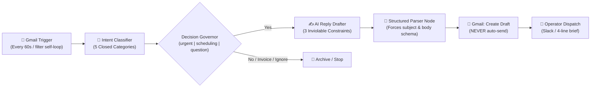

# Autonomous AI Agent Starter (Self-Healing Inbox Architecture)

[](https://opensource.org/licenses/MIT)
[](https://www.youtube.com/watch?v=hI8xuR7S49U)
[](https://www.python.org/)
[](https://n8n.io)
[](https://nexosailab.vercel.app)

Production-ready autonomous email triage and response agent with closed intent classification, structured output parsing, and iteration governors to eliminate runaway loops and empty draft payloads.

Designed and open-sourced by **Nexos AI Lab** as part of [**Episode VID_001**](https://www.youtube.com/watch?v=hI8xuR7S49U).

---

## 🎯 Architecture & Perception-Reasoning-Action Loop

Unlike brittle conversational chatbots, an autonomous agent continuously loops through **Perception**, **Reasoning**, and **Action** under deterministic governance.



---

## ⚙️ Core Engineering Invariants

1. **Self-Loop Prevention:**  
   The trigger strictly filters `from != owner_email` to prevent catastrophic feedback loops where an agent replies to its own broadcasts.
2. **Closed-Category Intent Classification:**  
   Evaluates true user intent across 5 rigid buckets: `urgent`, `scheduling`, `question`, `invoice`, and `ignore`.
3. **The 3 Inviolable Drafting Constraints:**
   - Answer *only* what the email asks.
   - Professional, concise tone (2–5 sentences).
   - Never invent facts: if dates, pricing, or specifications are missing, ask for clarification.
4. **Structured Output Parser (The Failure Fix):**  
   Forces the LLM to output discrete `{ "subject": "...", "body": "..." }` schemas, eliminating the #1 real-world failure mode where the email body generates cleanly but the subject header remains blank.
5. **Safety Guarantee:**  
   The agent creates drafts threaded under the original message; it **never triggers send**. The human operator retains 1-click execution authority.

---

## 📦 What's Included

```text
autonomous-agent-starter/
├── workflows/
│   └── inbox_agent_blueprint.json   # Ready-to-import visual n8n workflow
├── scripts/
│   └── inbox_agent.py               # Standalone pure-Python reference implementation
├── tests/
│   └── test_inbox_agent.py          # Unit test suite verifying safety invariants
├── .env.example                     # Environment template (Rule 17 compliant)
├── requirements.txt                 # Python dependencies
└── README.md                        # Documentation & blueprints
```

---

## 🚀 Quickstart

### Option A: Import to n8n (Visual No-Code)
1. Open your self-hosted or cloud [n8n](https://n8n.io) instance.
2. Click **Add Workflow** ➔ **Import from File...** ➔ Select `workflows/inbox_agent_blueprint.json`.
3. Connect your Gmail OAuth credentials and your LLM API key.
4. Activate the workflow.

### Option B: Run Pure Python Implementation
1. Clone this repository:
   ```bash
   git clone https://github.com/NexosAILab/autonomous-agent-starter.git
   cd autonomous-agent-starter
   ```
2. Install dependencies:
   ```bash
   pip install -r requirements.txt
   ```
3. Run the reference implementation:
   ```bash
   python scripts/inbox_agent.py
   ```
4. Run the automated test suite:
   ```bash
   python -m unittest discover -s tests -p "test_*.py"
   ```

---

## 📺 Episode Reference

- **Watch Episode VID_001:** [Build Your First Autonomous AI Agent in 15 Minutes](https://www.youtube.com/watch?v=hI8xuR7S49U)
- **Official Web Hub:** [nexosailab.vercel.app](https://nexosailab.vercel.app)
- **Follow on X:** [@NexosAILab](https://x.com/NexosAILab)

---

## 📄 License
This project is open-source under the [MIT License](LICENSE).
